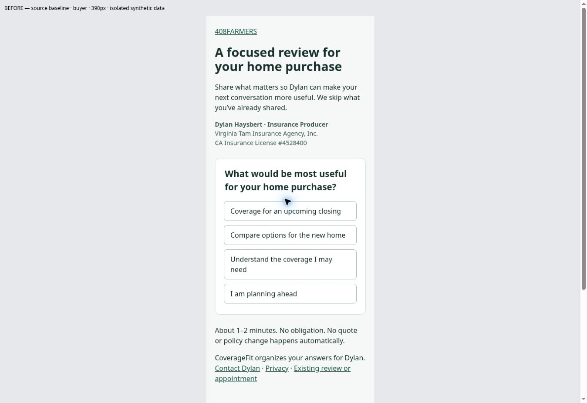
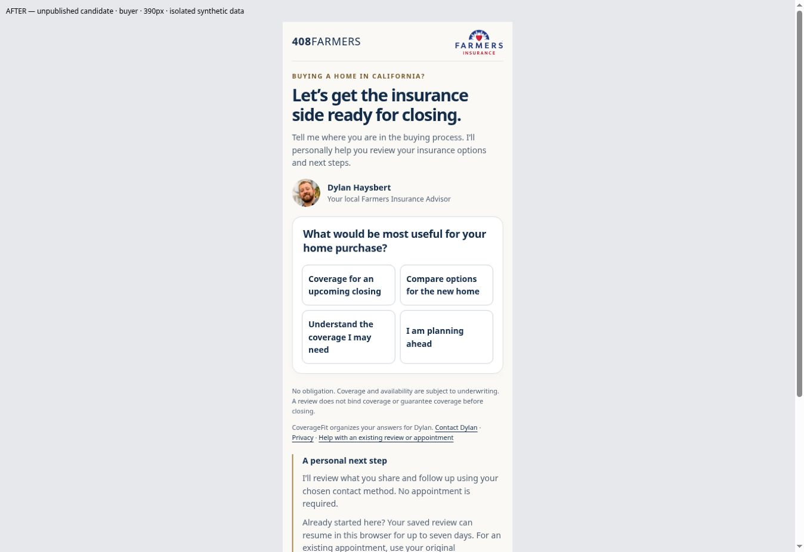
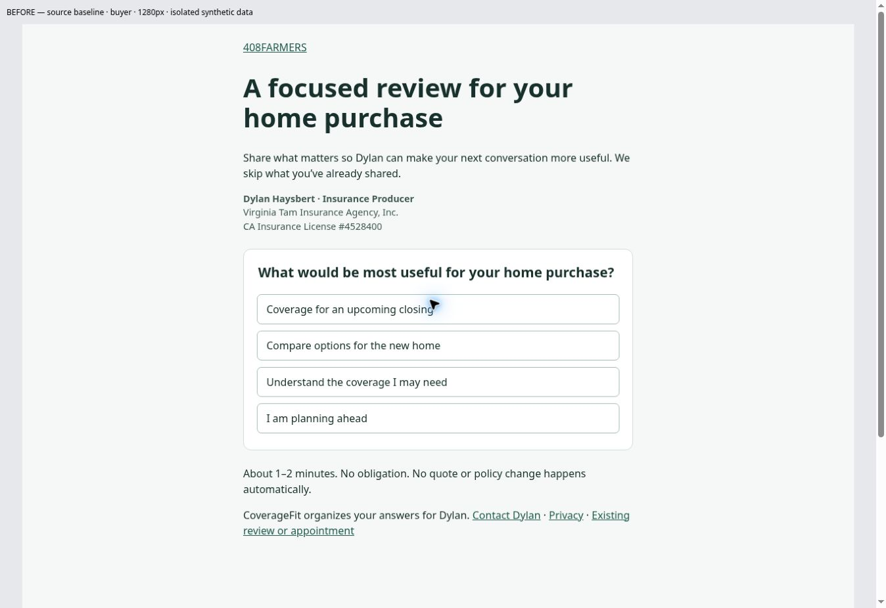
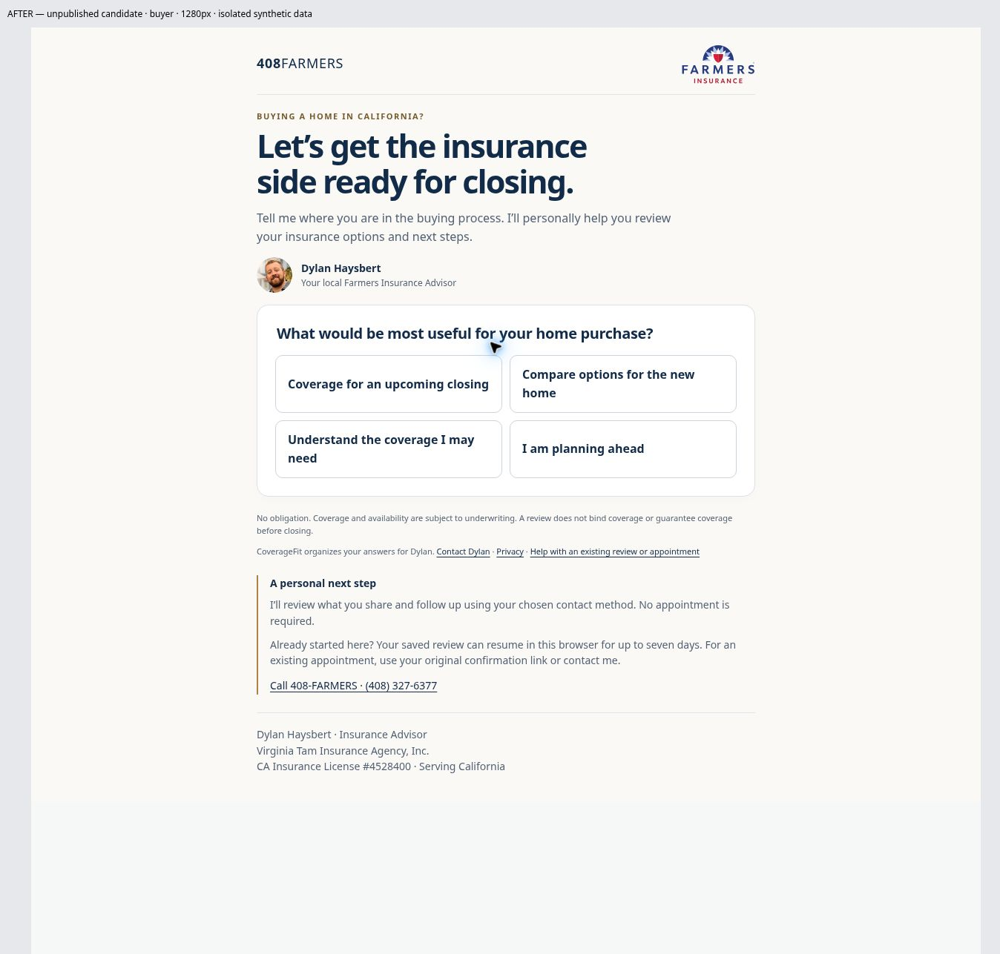
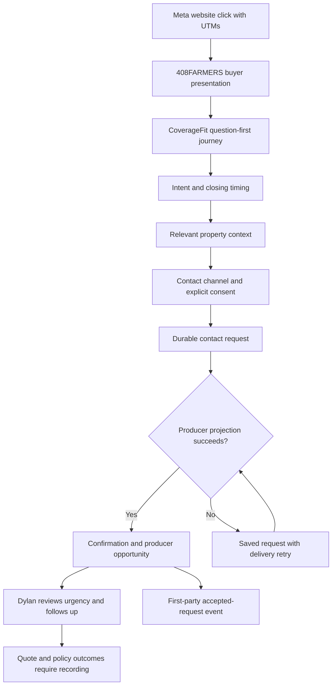

# 408FARMERS — Buyer Conversion 1.0

Mandate: 408FARMERS-BUYER-CONVERSION-1.0. October 24, 2026, Pacific.

**Disposition: NOT READY for paid Meta traffic. Implementation and isolated acceptance completed; production release and production-equivalent hosted acceptance remain outstanding.** No ad was launched, purchased, or changed. No production contact, external message, calendar booking, or AgencyZoom test lead was created.

## A. Baseline and implementation

Canonical acquisition source: `dhays4sports/408finneas`, main baseline `a695d4a` (merged affinity upgrade PR #5). Canonical intake source: `dhays4sports/CoverageFit`, main baseline `2cafacb`. Candidate branch in both repositories: `upgrade/buyer-conversion-1`. Acquisition is Cloudflare Pages, historically `408farmers-v2`, production branch main; `_worker.js` and `_routes.json` own buyer dispatch. The acquisition Worker retrieves CoverageFit `/api/distribution/presentation` and proxies `/api/entry/interact` and `/events`. Exact active Cloudflare deployment IDs, bindings and preview database isolation were not accessible/verified in this session.

A fresh live HTTP response confirmed the canonical question-first buyer page. Search retrieval still exposed the older two-step form. Live browser inspection confirmed the upgraded design on all four affinity routes and the old form at `/buyer/legacy.html`. Direct Python HTTP probes returned 403; these are recorded as failed probes, not site outages. The live browser succeeded. Existing browser cookies can resume an earlier shared review across audience routes; no session was erased or real contact submitted.

Implementation plan executed: reuse the affinity presentation; add bounded buyer questions inside CoverageFit's existing journey; carry buyer facts into existing producer projection; validate with real handlers and isolated SQLite; prepare coordinated release.

Visual changes: compact navy/warm-white/gold presentation, official existing Farmers SVG, authentic existing Dylan WebP, Insurance Advisor identity, California license, homebuyer headline and personal reassurance. First question stays in the opening view. No stock imagery, inference service, vendor, database or tracking pixel added.

Intake changes: preserve the four initial intents, ask closing window next, then optional ZIP, property type and identified-property status when useful. Searching buyers skip property type/status; urgent buyers skip the separate identified-property question. Known exact dates/types are retained. Unknown ZIP is allowed; a typed ZIP has format/range checks, not authoritative address verification. Full address and detailed underwriting remain a later conversation. Existing sessions retain their original journey; only new immediate buyer sessions use buyer flow version 1. Buyer ZIP/context lives in the existing private journey record, not analytics.

Contact: existing name + phone + personal call/text choice and explicit permission, with optional morning/afternoon/evening preference. Scheduling is not required. Contact form values survive Back within the page and a failed request. Unsubmitted contact drafts are memory-only and are not promised to survive reload. No email-only contact mode was added to the phone-based contract.

Producer changes: structured timing/ZIP/type/status, urgency, a concise known/unknown summary, preferred time and next action. Urgent closings have an explicitly titled producer task and direct-call option. Priority is a workflow suggestion; no policy-form, pricing, eligibility or binding decision is made. Requested channel remains authoritative; automated marketing stays unauthorized.

Navigation correction: replace the misleading legacy-intake link with **Help with an existing review or appointment**, pointing to existing contact help. Retain legacy routes and scripts byte-for-byte. Returning users may resume through their same-browser seven-day cookie; existing appointments use their original confirmation link. No appointment-manager capability is claimed.

## B. Before and after

Before images replay the fresh live buyer HTML with scripts disabled and local copies of current styles. After images show the isolated unpublished candidate. These are Chromium width-constrained frames, not real iPhone screenshots.

| Before | After |
|---|---|
| Generic review headline; text-only identity | Buyer/closing headline, approved logo and portrait |
| Generic home follow-ups | Closing window first; property context only as useful |
| Legacy link suggests appointment management | Clearly labeled help; original compatibility route preserved |
| General producer evidence | Explicit urgency, buyer facts, contact time, next action |

At frame widths 320, 390, 768 and 1280px, document width equaled available viewport width. At 320 the browser scrollbar reduced the content viewport to 305px. First question top: about 380px/347px/399px/399px respectively. Opening answer targets were at least 69px tall. Images loaded. Native labels, numeric ZIP keyboard hint, consent checkbox, focus outlines and question focus are retained. No real Meta WebView or performance benchmark was performed.

## C. Flow

A contact request can be made after the first answer, before completing all questions. Such a request is preserved, but is not automatically counted as a qualified buyer conversion. No calendar navigation occurs before persistence.

## D. Acceptance

| Required scenario | Result and scope |
|---|---|
| 1. Urgent single-family buyer | PASS isolated handler/SQLite and browser: consent, ZIP/type, urgent flag, durable source, one opportunity, direct call and attribution |
| 2. Condo buyer | PASS isolated: condo retained without HO-3/HO-6 assumption; near-term priority |
| 3. Early-stage buyer | PASS isolated: no date/address required; unknown ZIP and exploratory path; no forced appointment |
| 4. Abandoned scheduling | PARTIAL: accepted request persists on load/repeat; no schedule is created. Canonical scheduling interface does not exist, so calendar abandonment itself is not certified |
| 5. Returning visitor | PASS isolated: real presentation handler resumes cookie; Back correction, imported evidence, stale revision rejection and absent-cookie isolation tested. No cross-device resume promised |
| 6. Submission failure | PASS isolated: projection failure yields deliveryPending, retry recovers, concurrent retries yield one opportunity; browser form draft survives Back |
| 7. Meta mobile journey | PARTIAL: Chromium responsive layout and urgent submission pass; actual Facebook/Instagram iOS/Android in-app browser remains untested |
| 8. Attribution | PASS accepted UTM/source/creative contract and server-event deduplication; no Meta Pixel/CAPI certification or fbclid support |
| 9. Regression | PASS 63 acquisition tests, including 16 affinity route/product end-to-end cases; 34 buyer/distribution tests pass |

CoverageFit broad suite: **336 passed, 1 failed, 337 total**. Failure: `agencyzoom-raw.test.mjs`, expected /48 hours/, received “outside 7 days”. Reproduced on unchanged main baseline. No unrelated district-pilot policy or fixture was changed. This is not an all-green release claim. Evidence logs are in `buyer-evidence/`.

Browser acceptance used real request handlers and all current migrations with an in-memory SQLite database and empty provider environment. For local HTTP only, the QA harness removes Secure from the cookie and frame restrictions for viewport framing. Production headers/cookies remain unchanged. No Cloudflare/D1 production-equivalent hosted acceptance was completed.

## E. Integration condition

| Integration | Verified condition |
|---|---|
| CoverageFit persistence | Existing PVX record, private cookie, revision CAS, lead checkpoint, producer projection exercised with actual migrations in SQLite; no new schema |
| Producer visibility | Buyer evidence included in existing WEB_DIRECT lead source; summary and urgent task persisted; existing evidence renderer exposes facts |
| Duplicate handling | Same journey/bootstrap and retry path are idempotent; concurrent delivery retry tested. Existing identity matching is retained; no new automatic cross-contact merge policy |
| AgencyZoom | Existing lead record has pending CRM state. Buyer fields included in existing export projection. Canonical delivery calls producer projection, not synchronous AgencyZoom sync. Actual configured endpoint, scheduled retries and live CRM receipt are unverified; no sync was activated |
| Callback | Personal call/text request, optional time preference; no appointment is falsely created |
| Calendar | Existing legacy schedule/confirmation routes preserved. No new canonical appointment picker; live availability/booking not certified |
| Consent | Explicit selected-channel personal-review permission; no automatic marketing enrollment; anonymous answers do not permit contact |
| Attribution | Original distribution firstTouch and accepted UTMs/creative/partner context preserved. Return visit does not overwrite original source. Existing allowlist excludes fbclid; not silently broadened |
| Analytics | Existing first-party events retained. New server-only `buyer_qualified_request_accepted` fires only after durable request and producer receipt, with dedup by bootstrap/type |

The new event's operational qualification definition is explicit consent + valid phone/name, a known ZIP, one of single-family/condo/townhome, and a known non-exploratory closing window/date. This is contact-readiness, not underwriting qualification or a bound policy. Unknown/early-stage requests remain legitimate leads but do not emit that qualified event. Event writes remain best-effort under the existing contract; a measurement-write outage can undercount. No personal answers/contact data enter the event payload or third-party analytics. No active Pixel/CAPI was found in the canonical path; account-level Meta configuration is unverified.

Supported funnel: landing view → first answer/session start → completed questions → contact requested → producer receipt → qualified buyer event where applicable. Quote/bound/premium attribution and ad-account optimization require separate verification. No improved conversion rate is claimed.

## F. Release and rollback

Production `https://408farmers.com/buyer` was not changed. Candidate spans two repositories; acquisition CSS alone does not install buyer questions. Preview used during QA: `http://terminal.local:4173/?route=buyer&width=390` (session-local, not a public deployed staging URL). Source QA harness is `qa/buyer/server.mjs` with sibling `CoverageFit` checkout required. It must never be deployed as production code or given provider credentials.

Release order after gates: deploy CoverageFit candidate (including versioned entry client) to an isolated environment with synthetic-only D1 and no provider sends; validate acquisition candidate against that environment; review exact commits; then release backend before acquisition presentation. Verify production assets/cookies/CSP and producer receipt using a separately isolated/authorized test mechanism. Do not point synthetic tests at a live CRM.

Rollback presentation to acquisition baseline `a695d4a`; preserve backend support for buyerFlowVersion 1 sessions until they expire. A blind backend rollback would strand new buyer question IDs. If backend rollback is necessary, stop new buyer starts, preserve/export records, and plan compatibility handling for active seven-day sessions before restoring `2cafacb`. Never clear the prospect database. A frontend-only rollback is non-destructive but does not remove backend buyer questions.

## G. Meta launch readiness and remaining gates

**NOT READY to direct paid traffic yet.** Outstanding:

1. Coordinated release of the two candidates and production-equivalent isolated Cloudflare/D1 acceptance, including a verified producer receipt with current authorization/configuration.
2. Actual iPhone/Instagram/Facebook in-app smoke test (cookies, keyboard, Back, retry, submission).
3. Resolve or explicitly assess the inherited failing test before an all-green release decision.
4. Confirm operational owner access to the producer queue and follow-up process. AgencyZoom delivery is not certified; do not rely on it until verified.
5. Agency review of final insurance copy/brand use and ad-category setup. No Meta campaign creation/spend authority is included.

Meta identifies insurance as Financial Products and Services, requiring the applicable Special Ad Category and its audience restrictions. Check the current ad-account controls rather than reusing unrestricted targeting. Meta financial/insurance policy requires adult targeting. California CDI requires applicable license disclosure in marketing material. Existing approved branding is reused; this report is not Farmers compliance approval.

Official references reviewed October 24, 2026:
- https://www.facebook.com/business/help/1157846251802527
- https://www.facebook.com/business/help/510724041294968
- https://www.facebook.com/business/help/2220749868045706
- https://transparency.meta.com/policies/ad-standards/restricted-goods-services/financial-services/
- https://www.insurance.ca.gov/01-consumers/105-type/findagtbrk.cfm
- https://www.insurance.ca.gov/0250-insurers/0300-insurers/0200-bulletins/bulletin-notices-commiss-opinion/bulletin-96-08.cfm

Separate creative copy and requirements: `BUYER-META-CREATIVE-1.0.md`.
